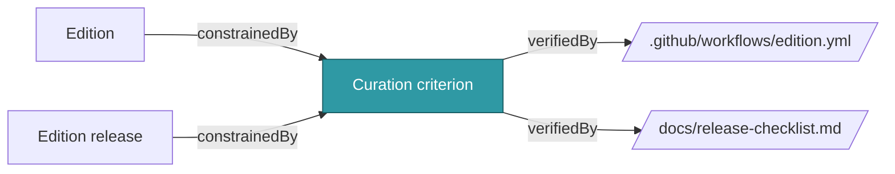

# Definition

A curation criterion is a condition an edition release must meet. Two are checked by CI: the functional tests of the compatibility run and the licenses. Three are reviewed by hand per release with the release checklist: accessibility (BFSG), data processing agreements (AVV) and the transparency duties of the EU AI Act. One is a membership rule: an accessibility overlay is never a member. The checklist records reviews; it certifies no site.

# Neighbours

Generated from the relation tables by `check-ontology.py --write-diagrams`. A solid arrow is an asserted relation, a dotted arrow a hypothesis; a slanted box is a file of the repository.

# Relations

| Relation | Target | Evidence file | Evidence text | Status |
|---|---|---|---|---|
| `verifiedBy` | `docs/release-checklist.md` | `docs/release-checklist.md` | `## Manual curation` | asserted |
| `verifiedBy` | `.github/workflows/edition.yml` | `docs/decisions/0001-typo3-ai-edition.md` | `Functional tests per release` | asserted |
