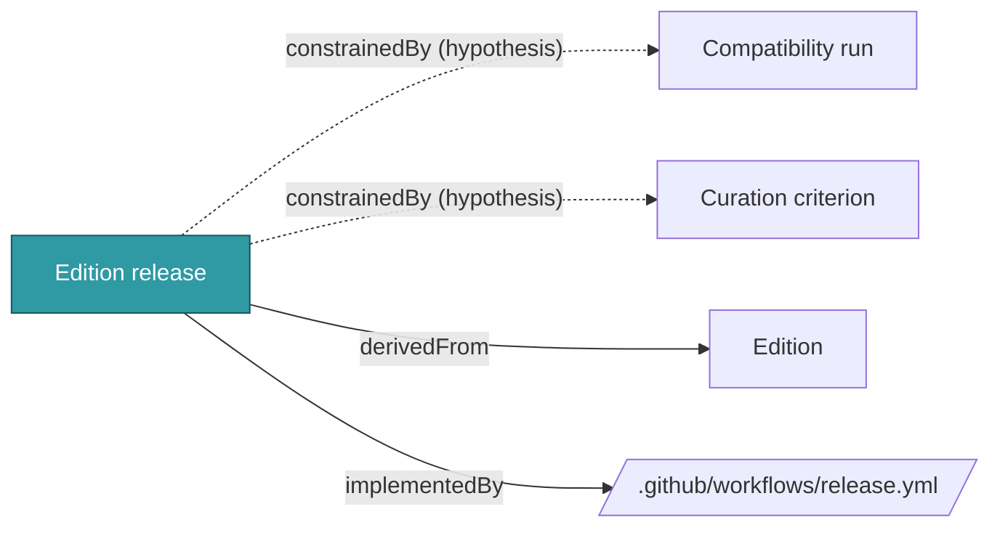

# Definition

An edition release is a tag `vX.Y.Z` of this repository; a workflow builds a signed source archive and the GitHub release, and Packagist reads the version from the tag. The edition follows SemVer: major when the supported TYPO3 LTS changes or a member is removed, minor when a member moves to a new minor or is added, patch when a floor rises within a minor or a `conflict` is added.

# Neighbours

Generated from the relation tables by `check-ontology.py --write-diagrams`. A solid arrow is an asserted relation, a dotted arrow a hypothesis; a slanted box is a file of the repository.

# Relations

| Relation | Target | Evidence file | Evidence text | Status |
|---|---|---|---|---|
| `derivedFrom` | [Edition](edition.md) | `.github/workflows/release.yml` | `tags: ['v*']` | asserted |
| `constrainedBy` | [Compatibility run](compatibility-run.md) |  |  | hypothesis |
| `constrainedBy` | [Curation criterion](curation-criterion.md) |  |  | hypothesis |
| `implementedBy` | `.github/workflows/release.yml` | `.github/workflows/release.yml` | `tags: ['v*']` | asserted |

# Notes

- Both `constrainedBy` rows are hypotheses. `.github/workflows/release.yml` runs on any pushed tag `v*` and checks neither a green compatibility run nor the curation criteria; `docs/release-checklist.md` asks a person to confirm both before tagging, and that is prose no code reads.
