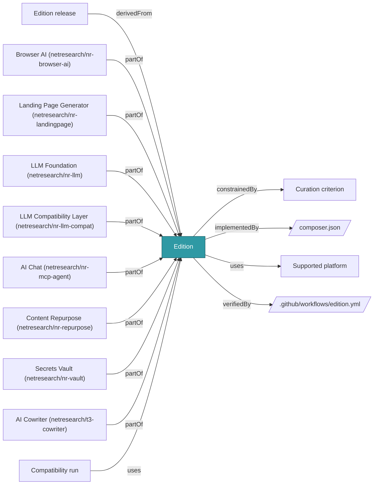

# Definition

The edition is the Composer metapackage `netresearch/typo3-ai-edition`. It contains no code; it carries the version ranges of its members. The compatibility run tests the lowest and the highest combination those ranges admit; a member patch published after the last run can be resolved by `composer require` before a run has tested it. ADR 0001 records the decision.

# Not to be confused with

- A TYPO3 distribution or site package: the edition imposes no site structure.
- An installation that uses the extensions, for example the TYPO3 demo instance: such an installation can require the members individually, in versions the edition has not tested.

# Neighbours

Generated from the relation tables by `check-ontology.py --write-diagrams`. A solid arrow is an asserted relation, a dotted arrow a hypothesis; a slanted box is a file of the repository.

# Relations

| Relation | Target | Evidence file | Evidence text | Status |
|---|---|---|---|---|
| `uses` | [Supported platform](supported-platform.md) | `composer.json` | `"typo3/cms-core": "^14.3"` | asserted |
| `constrainedBy` | [Curation criterion](curation-criterion.md) | `docs/decisions/0001-typo3-ai-edition.md` | `### Curation criteria` | asserted |
| `implementedBy` | `composer.json` | `composer.json` | `"type": "metapackage"` | asserted |
| `verifiedBy` | `.github/workflows/edition.yml` | `.github/workflows/edition.yml` | `name: Edition CI` | asserted |
