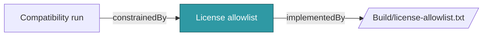

# Definition

The license allowlist lists the SPDX license identifiers that an installed package may carry. The compatibility run compares every installed package against it. A new identifier on the list is explained in a decision record.

# Neighbours

Generated from the relation tables by `check-ontology.py --write-diagrams`. A solid arrow is an asserted relation, a dotted arrow a hypothesis; a slanted box is a file of the repository.

# Relations

| Relation | Target | Evidence file | Evidence text | Status |
|---|---|---|---|---|
| `implementedBy` | `Build/license-allowlist.txt` | `Build/license-allowlist.txt` | `# SPDX identifiers a package installed by the edition may carry.` | asserted |
