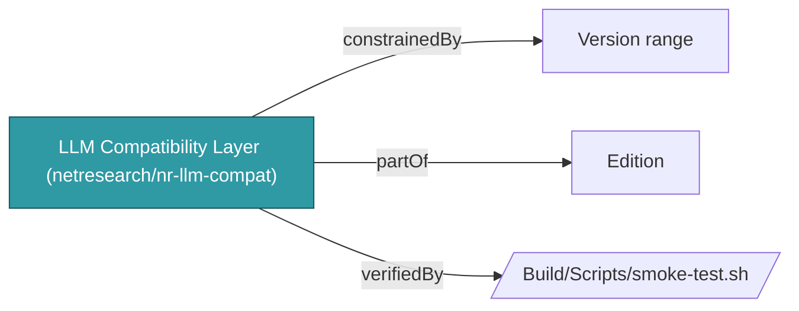

# Definition

LLM Compatibility Layer is the Composer package `netresearch/nr-llm-compat`. Routes the LLM calls of third-party AI extensions through nr-llm. It is a suggested member of the edition: a site installs it only on request, and the edition fences it to the tested range through `conflict`. Its version range in the edition admits patch releases of one minor version only.

# Neighbours

Generated from the relation tables by `check-ontology.py --write-diagrams`. A solid arrow is an asserted relation, a dotted arrow a hypothesis; a slanted box is a file of the repository.

# Relations

| Relation | Target | Evidence file | Evidence text | Status |
|---|---|---|---|---|
| `partOf` | [Edition](../edition.md) | `composer.json` | `"netresearch/nr-llm-compat": "Routes` | asserted |
| `constrainedBy` | [Version range](../version-range.md) | `composer.json` | `"netresearch/nr-llm-compat": "<` | asserted |
| `verifiedBy` | `Build/Scripts/smoke-test.sh` | `Build/Scripts/smoke-test.sh` | `SUGGESTED=(netresearch/nr-llm-compat netresearch/nr-browser-ai)` | asserted |
