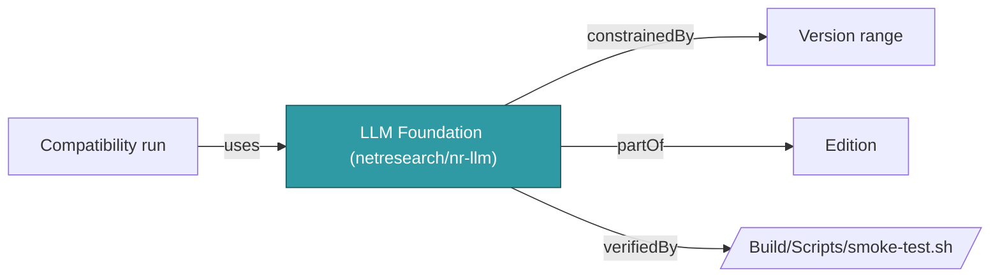

# Definition

LLM Foundation is the Composer package `netresearch/nr-llm`. Provider configuration, encrypted API keys, chat, translation, vision and embedding services for the members that build on it: t3-cowriter, nr-mcp-agent, nr-landingpage, nr-repurpose and nr-llm-compat. It is a required member of the edition. Its version range in the edition admits patch releases of one minor version only. The concepts inside nr-llm (providers, models, configurations) are modelled in the ontology bundle of its own repository: https://github.com/netresearch/t3x-nr-llm/tree/main/docs/ontology

# Neighbours

Generated from the relation tables by `check-ontology.py --write-diagrams`. A solid arrow is an asserted relation, a dotted arrow a hypothesis; a slanted box is a file of the repository.

# Relations

| Relation | Target | Evidence file | Evidence text | Status |
|---|---|---|---|---|
| `partOf` | [Edition](../edition.md) | `composer.json` | `"netresearch/nr-llm": "~` | asserted |
| `constrainedBy` | [Version range](../version-range.md) | `composer.json` | `"netresearch/nr-llm": "~` | asserted |
| `verifiedBy` | `Build/Scripts/smoke-test.sh` | `Build/Scripts/smoke-test.sh` | `declared=$(jq -r '.require \| keys[] \| select(startswith("netresearch/"))'` | asserted |
