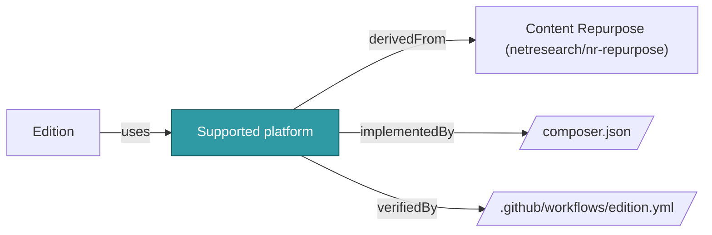

# Definition

The supported platform is the intersection of the constraints of all members: TYPO3 14.3 LTS and PHP `^8.3`, tested on 8.3, 8.4 and 8.5. TYPO3 13.4 is out, because Content Repurpose requires TYPO3 14.3.

# Neighbours

Generated from the relation tables by `check-ontology.py --write-diagrams`. A solid arrow is an asserted relation, a dotted arrow a hypothesis; a slanted box is a file of the repository.

# Relations

| Relation | Target | Evidence file | Evidence text | Status |
|---|---|---|---|---|
| `derivedFrom` | [Content Repurpose (netresearch/nr-repurpose)](members/nr-repurpose.md) | `docs/decisions/0001-typo3-ai-edition.md` | `TYPO3: nr-repurpose requires` | asserted |
| `verifiedBy` | `.github/workflows/edition.yml` | `.github/workflows/edition.yml` | `- { php: '8.5', deps: highest, suggested: '1' }` | asserted |
| `implementedBy` | `composer.json` | `composer.json` | `"php": "^8.3"` | asserted |

# Notes

- Only nr-repurpose is modelled as a source of the platform, because ADR 0001 names it as the member that sets the TYPO3 and PHP floor. A new minor of another member can narrow the platform too; its constraints are in that member's own `composer.json`.
