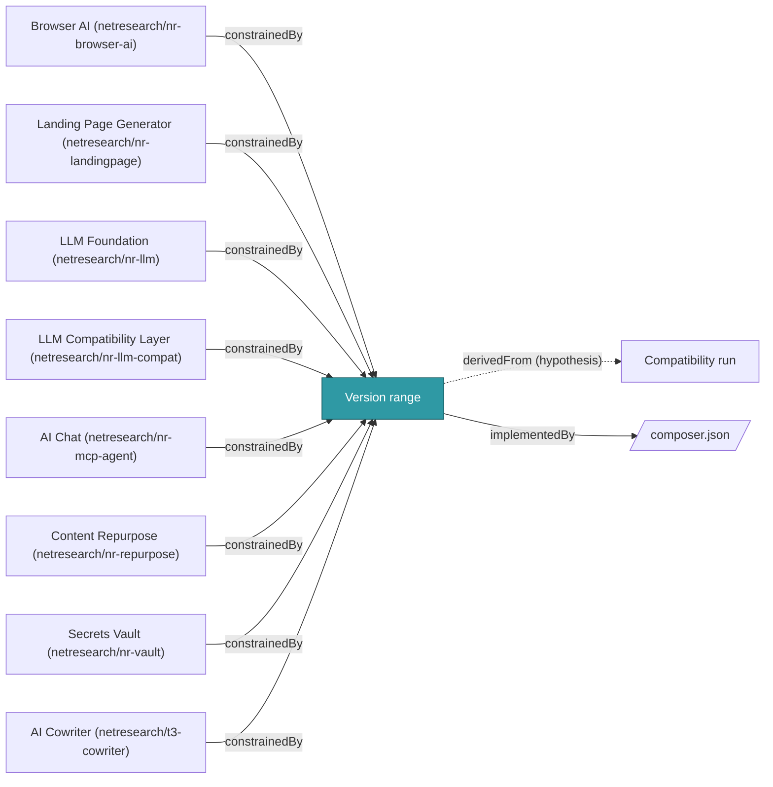

# Definition

The version range of a required member has the form `~X.Y.Z`: X.Y.Z is a version a green compatibility run installed, and later patch releases of the same minor are admitted. The edition never pulls in a new minor version of a member; a new minor arrives with a new edition release after the compatibility run passed for it. A suggested member is fenced the same way through `conflict`.

# Neighbours

Generated from the relation tables by `check-ontology.py --write-diagrams`. A solid arrow is an asserted relation, a dotted arrow a hypothesis; a slanted box is a file of the repository.

# Relations

| Relation | Target | Evidence file | Evidence text | Status |
|---|---|---|---|---|
| `implementedBy` | `composer.json` | `composer.json` | `"netresearch/nr-llm": "~` | asserted |
| `derivedFrom` | [Compatibility run](compatibility-run.md) |  |  | hypothesis |

# Notes

- `derivedFrom` Compatibility run is a hypothesis: a person bumps the floors in `composer.json` to the versions a green run installed (step 1 of the release steps in `docs/release-checklist.md`). No code of this repository writes the ranges from a run; `Build/Scripts/smoke-test.sh` reads the floors out of `composer.json`, the opposite direction.
